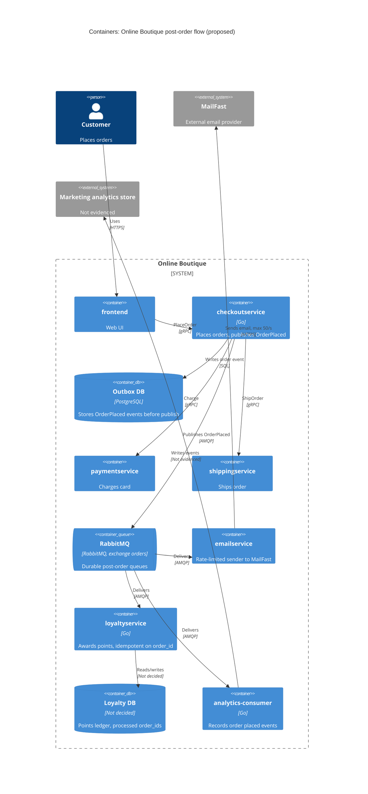

# ADR-0002: Publish an "OrderPlaced" event to RabbitMQ for post-order actions

- **Status:** Proposed
- **Date:** 2026-10-25
- **Deciders:** ทีมพัฒนา Online Boutique (4 developers ตาม `docs/scenario.md`) — ยังไม่ระบุชื่อผู้ตัดสินใจ

> ร่าง ADR สำหรับ requirement R-12 (`docs/scenario.md`) เขียนตามรูปแบบของ `docs/adr/0001-use-redis-for-cart-storage.md`

## Context and problem

**ปัจจุบัน:** `checkoutservice.PlaceOrder` ทำงานแบบ synchronous ตามลำดับ: charge card → ship order → empty cart → ส่ง email แล้วจึงตอบกลับลูกค้า (`system/online-boutique/src/checkoutservice/main.go`, `PlaceOrder` บรรทัด 252–279) ถ้า email ล้มเหลว จะแค่ `log.Warnf` และ order ยังสำเร็จ (บรรทัด 273–277) การเรียก `emailservice` ใช้ gRPC client ตัวเดียวที่ hard-wire ไว้ (`emailSvcConn`, `EMAIL_SERVICE_ADDR` บรรทัด 81–82, 115, 122; `sendOrderConfirmation` บรรทัด 379–384) และ `checkoutservice` ไม่มี data store ของตัวเอง (ใน `main.go` มีแค่ gRPC connections ไปยัง service อื่น)

**Requirement R-12:** หลัง order สำเร็จต้อง (1) ส่ง email ผ่าน **MailFast** (external) แทน mock `emailservice` (2) ให้ loyalty points ผ่าน `loyaltyservice` ใหม่ (3) บันทึก analytics event "order placed" และปีหน้าจะมี post-order actions เพิ่ม (SMS, fraud scoring, recommendations update)

**ตัวเลขที่เกี่ยวข้อง** (`docs/scenario.md`):

| Fact | ค่า | ผลต่อการออกแบบ |
|---|---|---|
| p95 `PlaceOrder` | ≤ 500 ms (ปัจจุบันประมาณ 300 ms) | เหลือ budget ประมาณ 200 ms |
| MailFast latency | p95 1.5 s, p99 8 s | เรียกแบบ synchronous ใน `PlaceOrder` จะทำให้ p95 ประมาณ 1.8 s → ผิดเป้า 500 ms ทันที |
| MailFast rate limit | 50 emails/s | peak 200 orders/s (11.11) → เกิน rate limit 4 เท่า ต้องมี buffer; backlog โตประมาณ 150 emails/s (= 9,000 ต่อนาที) |
| MailFast failure | ประมาณ 0.5 % | ประมาณ 1 call/s ล้มเหลวที่ peak → ต้องมี retry |
| Loyalty points | ภายใน 1 นาที, **exactly once** | ต้องมี delivery ที่ไม่หาย + การกันซ้ำ (idempotency) |
| Availability | order ห้าม fail เพราะ email/loyalty/analytics ล่ม | post-order actions ต้องแยกออกจาก critical path |
| Team | Go + gRPC แข็ง, 2 คนเคยใช้ RabbitMQ | ลด learning curve ถ้าเลือก RabbitMQ |
| Operations | Kubernetes; ชอบ open-source, self-hosted | ตัด managed cloud-only (เช่น Pub/Sub, SQS) ออก |

**ปัญหาที่ต้องตัดสินใจ:** จะเชื่อม `checkoutservice` กับ post-order actions (ทั้ง 3 อย่างตอนนี้ และที่จะเพิ่มในอนาคต) อย่างไร ให้ checkout ยังเร็ว ไม่ fail ตาม downstream และรองรับ rate limit ของ MailFast

## Decision drivers

1. **Availability:** order ต้องไม่ fail เพราะ email, loyalty หรือ analytics ล่ม
2. **Performance:** p95 `PlaceOrder` ≤ 500 ms ที่ 200 orders/s
3. **Reliability / correctness:** loyalty points ต้องได้ภายใน 1 นาที และ exactly once; email ต้องไม่หายแม้ MailFast ล้ม 0.5 % หรือติด rate limit 50/s
4. **Modifiability:** เพิ่ม action ใหม่ (SMS, fraud scoring, recommendations) ได้โดยไม่แก้ `checkoutservice` ทุกครั้ง
5. **Team fit และ cost:** ทีม 4 คน, ถนัด Go/gRPC, เคยใช้ RabbitMQ; ต้อง self-hosted บน Kubernetes

## Considered options

1. **Synchronous gRPC fan-out:** ขยาย `PlaceOrder` ให้เรียก MailFast adapter, `loyaltyservice` และ analytics ต่อกันแบบ synchronous (แบบเดียวกับ `emailservice` วันนี้)
2. **In-process async:** `PlaceOrder` ตอบลูกค้าก่อน แล้วยิง post-order calls ใน goroutines พร้อม retry ภายใน `checkoutservice`
3. **Event-driven ผ่าน RabbitMQ (self-hosted):** `checkoutservice` publish event `OrderPlaced` ไปที่ exchange; แต่ละ action เป็น consumer แยก queue
4. **Event log ผ่าน Apache Kafka (self-hosted):** เหมือนข้อ 3 แต่ใช้ Kafka topic

### Pros and cons of the options

| Option | Pros | Cons |
|---|---|---|
| 1. Sync gRPC fan-out | ง่ายที่สุด ทีมถนัด; ไม่มี component ใหม่; เห็นผลลัพธ์ทันที | MailFast p95 1.5 s ทำให้ผิดเป้า 500 ms; ติด rate limit 50/s ที่ 200 orders/s; ทุก action ใหม่ต้องแก้ `PlaceOrder` (coupling สูง); downstream ช้า = checkout ช้า |
| 2. In-process async (goroutines) | ไม่กระทบ latency ของ checkout; ไม่มี infra ใหม่ | งานค้างอยู่ใน memory → pod restart/scale-down = email/points หาย (ผิด exactly once); คุม rate limit 50/s ข้าม replicas ยาก; ยังต้องแก้ `checkoutservice` ทุก action ใหม่ |
| 3. RabbitMQ events | Publish ใช้เวลาน้อย ไม่ต้องรอ MailFast; queue เป็น buffer รองรับ burst 200/s แล้วค่อย drain 50/s; durable queues + ack/retry/dead-letter; action ใหม่ = แค่เพิ่ม queue + consumer; open-source, self-hosted; 2 คนในทีมเคยใช้ | Component ใหม่ที่ต้อง operate (cluster, monitoring); delivery เป็น at-least-once → `loyaltyservice` ต้อง idempotent เอง; eventual consistency (email มาช้าได้); ต้องจัดการกรณี broker ล่มตอน publish |
| 4. Kafka event log | Throughput สูง; replay event ได้ (มีประโยชน์กับ analytics และ consumer ใหม่ในอนาคต); open-source | ทีมไม่มีประสบการณ์ (Not evidenced ว่ามีใครเคยใช้); operate ยากกว่าสำหรับทีม 4 คน; rate limiting / retry ต่อข้อความต้องเขียนเองมากกว่า; throughput เกินความต้องการ 200 msg/s มาก |

## Decision

เลือก **Option 3: Event-driven ผ่าน RabbitMQ (self-hosted บน Kubernetes)**

ภาพรวม:

- `PlaceOrder` หลัง charge + ship สำเร็จ จะ publish event `OrderPlaced` (มี `order_id` จาก `uuid.NewUUID()` บรรทัด 233, email, items, total, user_id) ไปที่ topic exchange `orders` แทนการเรียก `sendOrderConfirmation` แบบ synchronous
- แต่ละ action มี queue ของตัวเอง (durable) bind กับ exchange:
  - `emailservice` (แก้ตัวเดิม: เปลี่ยนจาก mock เป็น consumer ที่อ่านจาก queue) → เรียก MailFast ด้วย rate limiter 50/s รวมทุก replica, retry แบบ backoff และส่งไป dead-letter queue เมื่อเกินจำนวนครั้ง
  - `loyaltyservice` (ใหม่) → ให้ points แบบ idempotent โดยใช้ `order_id` เป็น unique key (at-least-once delivery + idempotent consumer = ผลลัพธ์ exactly once)
  - `analytics-consumer` → บันทึก event "order placed" (ปลายทางยังไม่ระบุ ดู Open questions)
- ใช้ transactional outbox: checkoutservice บันทึก event OrderPlaced ลงตาราง outbox ใน PostgreSQL (open-source, self-hosted) พร้อมกับการสร้าง order แล้วมีตัวส่ง (relay) อ่านจาก outbox ไป publish ที่ RabbitMQ ถ้า RabbitMQ ล่ม event ยังอยู่ใน DB และส่งต่อได้เมื่อกลับมา

เหตุผล: เป็นตัวเลือกเดียวที่ผ่าน driver 1–3 พร้อมกัน — แยก MailFast (p95 1.5 s, 50/s) ออกจาก critical path, buffer burst ของ 11.11 และให้ durability ที่ Option 2 ไม่มี; ได้ modifiability (driver 4) เพราะ action ใหม่แค่ subscribe; และเหมาะกับทีม (driver 5) มากกว่า Kafka

## Consequences

- **Positive:** `PlaceOrder` ไม่ต้องรอ MailFast/loyalty/analytics อีกต่อไป → p95 ไม่ได้รับผลจาก MailFast 1.5 s (quality attribute: performance)
- **Positive:** email, loyalty หรือ analytics ล่ม ไม่ทำให้ order fail; ข้อความรออยู่ใน durable queue จน consumer กลับมา (quality attribute: availability)
- **Positive:** queue ดูดซับ burst 200 orders/s แล้ว drain ไป MailFast ที่ 50/s; retry + dead-letter รองรับ failure 0.5 % (quality attribute: reliability)
- **Positive:** เพิ่ม SMS, fraud scoring, recommendations ได้ด้วยการเพิ่ม queue + consumer โดยไม่แก้ `checkoutservice` (quality attribute: modifiability)
- **Positive:** `checkoutservice` ไม่ต้องรู้จัก service ปลายทางทีละตัว (ไม่ต้องเพิ่ม `*_SERVICE_ADDR` ใหม่แบบบรรทัด 111–123) (quality attribute: modifiability / coupling)
- **Negative:** checkoutservice ต้องมี PostgreSQL เพิ่ม 1 ตัวสำหรับ outbox และต้องมี relay ส่ง event ออก (quality attribute: cost / operability)
- **Negative:** มี stateful component ใหม่ (RabbitMQ cluster) ที่ต้อง deploy, monitor และ upgrade บน Kubernetes (quality attribute: cost / operability)
- **Negative:** email กลายเป็น eventual: ช่วง 11.11 backlog โตประมาณ 150 emails/s ระหว่าง peak; ลูกค้าอาจได้ email ช้าหลายนาทีถึงหลายชั่วโมงขึ้นกับความยาวของ peak (quality attribute: performance ฝั่ง user experience)
- **Negative:** debug ยากขึ้น เพราะ flow ข้าม broker; ต้องส่ง trace context ใน message header ต่อจาก OpenTelemetry ที่มีอยู่ (`main.go` บรรทัด 134–140) (quality attribute: observability)
- **Risks and mitigations:**
  - *Event หายถ้า broker ล่มตอน publish* (dual-write: order สำเร็จแต่ไม่มี event → ไม่มี points): **แก้ด้วย transactional outbox** — `checkoutservice` บันทึก event ลงตาราง outbox ใน PostgreSQL ใน transaction เดียวกับการสร้าง order แล้ว relay อ่านไป publish ที่ RabbitMQ พร้อม publisher confirms ถ้า RabbitMQ ล่ม event ยังค้างอยู่ใน outbox และถูกส่งเมื่อกลับมา จึงไม่มี order ไหนที่ไม่ได้ points
  - *Double points จาก redelivery:* `loyaltyservice` เก็บ `order_id` ที่ประมวลผลแล้วใน transaction เดียวกับการเพิ่ม points (unique constraint)
  - *ส่ง email ซ้ำ:* MailFast อาจรับซ้ำเมื่อ retry หลัง timeout (p99 8 s) — ใช้ `order_id` เป็น idempotency key ถ้า MailFast รองรับ (Not evidenced in the provided files)
  - *Loyalty ช้ากว่า 1 นาทีตอน peak:* แยก queue ของ loyalty จาก email (ไม่ติด rate limit ของ MailFast) และ scale consumer ให้รับ ≥ 200 msg/s; ตั้ง alert เมื่อ queue age > 30 s
  - *RabbitMQ เป็น single point of failure ของ post-order:* รันเป็น cluster 3 nodes พร้อม quorum queues **[Inferred]** จากแนวปฏิบัติทั่วไป ต้องยืนยันกับทีม ops

## Validation

- **Load test** ที่ 200 orders/s: p95 `PlaceOrder` ≤ 500 ms โดยวัดเวลา publish แยก
- **Fault injection:** ปิด `emailservice`, `loyaltyservice`, analytics consumer และ RabbitMQ ทีละตัวระหว่าง load test → order success rate ต้องไม่ลดลง
- **Loyalty:** วัด lag ระหว่าง order กับการได้ points (p99 < 60 s ที่ peak) และ reconcile จำนวน orders เทียบกับ points records → ต้องไม่มีซ้ำและไม่ขาด
- **MailFast:** ยืนยันว่าอัตราส่งไม่เกิน 50/s (ไม่มี HTTP 429 หรือเทียบเท่า), dead-letter queue ≈ 0 หลัง retry, และวัดเวลาที่ใช้ drain backlog หลัง peak
- **Review date:** ทบทวน ADR นี้หลัง 11.11 ครั้งแรก หรือเมื่อเริ่มเพิ่ม post-order action ใหม่ (SMS / fraud scoring)

## Open questions

- **Email latency target:** ไม่ได้ระบุว่า email ต้องถึงลูกค้าภายในเวลาเท่าไร — สำคัญเพราะที่ 200 orders/s backlog จะโตประมาณ 9,000 emails/นาที
- **ระยะเวลาของ peak 11.11:** ไม่ทราบว่า 200 orders/s ยาวนานเท่าไร จึงคำนวณขนาด backlog / disk ของ RabbitMQ และเวลา drain ไม่ได้
- **ขอเพิ่ม rate limit ของ MailFast ได้หรือไม่** หรือมี batch API / idempotency key หรือไม่ (Not evidenced in the provided files)
- **Analytics ปลายทาง:** marketing ใช้ระบบหรือ store อะไรรับ event "order placed" และต้องการ delivery guarantee ระดับไหน (ยอมหายได้บ้างหรือไม่)
- **Data store ของ `loyaltyservice`:** ยังไม่ได้เลือก (ต้องรองรับ unique constraint บน `order_id`)
- **Fraud scoring ปีหน้า:** ถ้าต้อง *บล็อก* order ก่อนสำเร็จ จะเป็น synchronous step ใน `PlaceOrder` ไม่ใช่ post-order event — ต้องยืนยันกับ marketing
- **ทักษะ operate RabbitMQ บน Kubernetes:** 2 คนเคย "ใช้" RabbitMQ แต่ไม่ทราบว่าเคย operate cluster ใน production หรือไม่
- **Latency ของการ publish ไป RabbitMQ:** ไม่มีตัวเลขใน context ต้องวัดจริงใน load test
