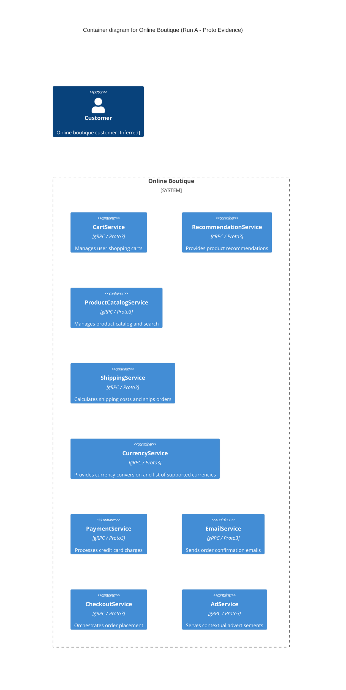

# Architecture Recovery: Online Boutique (Run A)

## 1. Agent
- **Product:** Antigravity (Google DeepMind)
- **Model:** Gemini 3.8 Flash (High)

## 2. Files read
- `prompts/1-recover-architecture.md`
- `system/online-boutique/protos/demo.proto`

## 3. Containers table

| Name | Technology / Language | Responsibility | Evidence (file path) |
| :--- | :--- | :--- | :--- |
| `CartService` | gRPC / Protocol Buffers (proto3)  *(Implementation language: Not evidenced in the provided files)* | Manages user shopping cart items (adding items, retrieving cart, emptying cart) | `system/online-boutique/protos/demo.proto:23-27` |
| `RecommendationService` | gRPC / Protocol Buffers (proto3)  *(Implementation language: Not evidenced in the provided files)* | Computes and returns product recommendations based on user ID and product IDs | `system/online-boutique/protos/demo.proto:56-58` |
| `ProductCatalogService` | gRPC / Protocol Buffers (proto3)  *(Implementation language: Not evidenced in the provided files)* | Stores and queries product catalog, retrieves individual products by ID, and searches products | `system/online-boutique/protos/demo.proto:71-75` |
| `ShippingService` | gRPC / Protocol Buffers (proto3)  *(Implementation language: Not evidenced in the provided files)* | Calculates shipping quotes and processes order shipments to produce tracking IDs | `system/online-boutique/protos/demo.proto:107-110` |
| `CurrencyService` | gRPC / Protocol Buffers (proto3)  *(Implementation language: Not evidenced in the provided files)* | Returns supported currencies and converts monetary values between currencies | `system/online-boutique/protos/demo.proto:140-143` |
| `PaymentService` | gRPC / Protocol Buffers (proto3)  *(Implementation language: Not evidenced in the provided files)* | Processes credit card charges and returns transaction IDs | `system/online-boutique/protos/demo.proto:177-179` |
| `EmailService` | gRPC / Protocol Buffers (proto3)  *(Implementation language: Not evidenced in the provided files)* | Sends order confirmation emails with shipping and order details | `system/online-boutique/protos/demo.proto:199-201` |
| `CheckoutService` | gRPC / Protocol Buffers (proto3)  *(Implementation language: Not evidenced in the provided files)* | Handles end-to-end order placement | `system/online-boutique/protos/demo.proto:224-226` |
| `AdService` | gRPC / Protocol Buffers (proto3)  *(Implementation language: Not evidenced in the provided files)* | Retrieves contextual advertisements based on context keys | `system/online-boutique/protos/demo.proto:243-245` |

## 4. Dependencies table

| Caller → Callee | Protocol | Evidence (file path and symbol or env var) |
| :--- | :--- | :--- |
| *None evidenced* | *Not evidenced in the provided files* | *Not evidenced in `system/online-boutique/protos/demo.proto`* |

> [!NOTE]
> `demo.proto` defines gRPC interface contracts, RPC signatures, and message schemas. It does not define runtime invocation relationships, client stubs, or caller bindings. While certain message types are shared across services (e.g., `CartItem` in `ShippingService` and `CartService`), actual runtime caller-to-callee dependencies are not evidenced in the IDL file alone and are documented under **Gaps**.

## 5. Mermaid diagram

## 6. Gaps

- **Runtime Call Dependencies (Caller → Callee):**
  - *Undetermined:* Which services invoke which other services at runtime (e.g., whether `CheckoutService` orchestrates calls to `CartService`, `PaymentService`, `ShippingService`, `CurrencyService`, and `EmailService`).
  - *Extra file to settle:* Service source code (e.g., `src/checkoutservice/main.go` or `src/checkoutservice/`) or Kubernetes deployment manifests specifying service address environment variables (e.g., `kubernetes-manifests/*.yaml`).
- **Frontend / Entrypoint Container:**
  - *Undetermined:* How end users access the store or interface with the gRPC services (e.g., whether an HTTP/web UI, API gateway, or reverse proxy exists).
  - *Extra file to settle:* Kubernetes manifests (`system/online-boutique/kubernetes-manifests/frontend.yaml`) or frontend source directory (`src/frontend/`).
- **Service Implementation Languages / Technologies:**
  - *Undetermined:* The underlying programming language and runtime framework used to implement each service (e.g., Go, Python, Java, Node.js, C#). `demo.proto` defines `option go_package`, but this only governs protobuf Go code generation and does not indicate the languages of other services.
  - *Extra file to settle:* Service source directories and Dockerfiles (`src/*/Dockerfile`).
- **Databases and Persistent Storage:**
  - *Undetermined:* Where and how state is stored (e.g., shopping cart persistence, product catalog database, cache). No databases (`ContainerDb`) or message queues (`ContainerQueue`) appear in `demo.proto`.
  - *Extra file to settle:* Kubernetes manifests (e.g., `system/online-boutique/kubernetes-manifests/redis.yaml`) or service implementation code (`src/cartservice/`).
- **External Systems / Third-Party Services:**
  - *Undetermined:* Whether any service depends on external third-party APIs (e.g., real payment processors, shipping carriers, external mail servers).
  - *Extra file to settle:* Service source code (`src/paymentservice/`, `src/shippingservice/`, `src/emailservice/`).
- **Deployment Topology and Network Protocols:**
  - *Undetermined:* Port numbers, ingress rules, service discovery mechanisms, and TLS/mTLS configurations.
  - *Extra file to settle:* Kubernetes manifests (`system/online-boutique/kubernetes-manifests/`).
