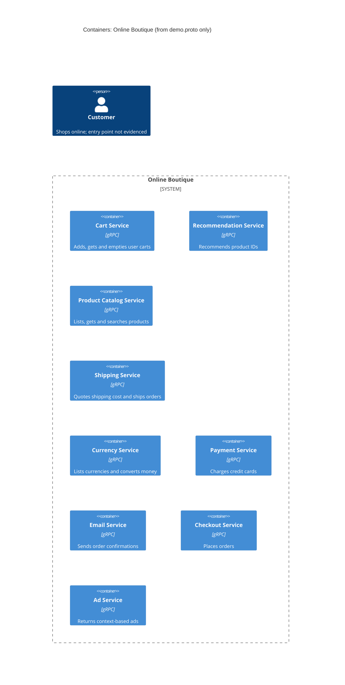

# Task 1 — Run A: Recovered C4 container architecture

## 1. Agent

Claude Code (Anthropic), model Claude Opus 5.5 (`claude-opus-5-5`).

## 2. Files read

- `prompts/1-recover-architecture.md` (task file)
- `system/online-boutique/protos/demo.proto` (only evidence file)

## 3. Containers table

The proto file defines gRPC service interfaces (`package hipstershop`). Each `service` is listed as one container. The proto **does not** show the implementation language, deployment, or data stores of any service. The `option go_package` line (line 19) only sets the package for generated Go stubs. It does not show that any service is written in Go.

| Container | Technology / language | Responsibility (from RPCs) | Evidence |
|---|---|---|---|
| Cart Service | gRPC API; language not evidenced | Add items to a user's cart, get the cart, empty the cart | `system/online-boutique/protos/demo.proto` (`service CartService`, l.23–27: `AddItem`, `GetCart`, `EmptyCart`) |
| Recommendation Service | gRPC API; language not evidenced | Return recommended product IDs for a user and a list of products | `demo.proto` (`service RecommendationService`, l.56–58: `ListRecommendations`) |
| Product Catalog Service | gRPC API; language not evidenced | List, get and search products (id, name, description, picture, price, categories) | `demo.proto` (`service ProductCatalogService`, l.71–75; `message Product`, l.77–87) |
| Shipping Service | gRPC API; language not evidenced | Quote shipping cost for an address and items; ship an order and return a tracking ID | `demo.proto` (`service ShippingService`, l.107–110: `GetQuote`, `ShipOrder`) |
| Currency Service | gRPC API; language not evidenced | List supported currencies; convert money between ISO 4217 currencies | `demo.proto` (`service CurrencyService`, l.140–143: `GetSupportedCurrencies`, `Convert`) |
| Payment Service | gRPC API; language not evidenced | Charge a credit card for an amount; return a transaction ID | `demo.proto` (`service PaymentService`, l.177–179: `Charge`; `message CreditCardInfo`, l.181–186) |
| Email Service | gRPC API; language not evidenced | Send an order confirmation to an email address | `demo.proto` (`service EmailService`, l.199–201: `SendOrderConfirmation`) |
| Checkout Service | gRPC API; language not evidenced | Place an order for a user (address, email, card, currency); return an `OrderResult` | `demo.proto` (`service CheckoutService`, l.224–226: `PlaceOrder`; `message PlaceOrderRequest`, l.228–235) |
| Ad Service | gRPC API; language not evidenced | Return ads (text and redirect URL) for page context keywords | `demo.proto` (`service AdService`, l.243–245: `GetAds`) |

Data stores: **Not evidenced in the provided files.** No database, cache or message broker appears in the proto.

## 4. Dependencies table

| Caller → Callee | Protocol | Evidence |
|---|---|---|
| — | — | **Not evidenced in the provided files.** A `.proto` file declares what each service *offers* (server-side interfaces). It does not say which service *calls* which. There is no client code, address configuration or environment variable here. |

Possible dependencies that the message shapes suggest are listed under **Gaps** as **[Inferred]**. They are not in the table or the diagram.

## 5. Mermaid diagram

The diagram matches the tables. There are 9 containers and no `Rel` lines, because the evidence shows no dependencies. The end user is shown, but how they reach the system (for example through a web front end) is not evidenced, so no relationship is drawn.

## 6. Gaps

| Gap | Why it can't be settled from the evidence | File that would settle it |
|---|---|---|
| Implementation language of each service | The proto is language-neutral. `go_package` (l.19) only configures Go code generation. | Each service's source folder or `Dockerfile` under `system/online-boutique/src/<service>/` |
| Front end / UI container (how the `Customer` reaches the system) | No HTTP or web service is defined in the proto. **[Inferred]** Some client must call `ListProducts`, `GetCart`, `GetAds`, `PlaceOrder`, etc. | `system/online-boutique/src/frontend/` source; `system/online-boutique/kubernetes-manifests/frontend.yaml` |
| **[Inferred]** Checkout Service → Cart, Product Catalog, Currency, Shipping, Payment, Email (gRPC) | `PlaceOrderRequest` (l.228–235) carries `user_id`, `user_currency`, `Address`, `email` and `CreditCardInfo`. These are the inputs to `GetCart`, `Convert`, `GetQuote`/`ShipOrder`, `Charge` and `SendOrderConfirmation`. `OrderResult` (l.208–214) holds `shipping_tracking_id` and `shipping_cost`, which `ShipOrder` and `GetQuote` return. Shared message types show the design intent. They do not prove calls. | `system/online-boutique/src/checkoutservice/` source; `system/online-boutique/kubernetes-manifests/checkoutservice.yaml` (`*_SERVICE_ADDR` env vars) |
| **[Inferred]** Recommendation Service → Product Catalog Service | `ListRecommendations` returns product IDs, which suggests it needs the catalog. Not shown. | `system/online-boutique/src/recommendationservice/` source; its Kubernetes manifest |
| Data stores (e.g. where carts, products and ads are kept) | No storage is mentioned. Cart state is keyed by `user_id` (l.39–50), but where it is persisted is not shown. | `system/online-boutique/kubernetes-manifests/` (e.g. a cart store deployment); `src/cartservice/` source |
| External systems (real payment provider, email provider) | `Charge` and `SendOrderConfirmation` exist, but whether they call outside systems or are stubs is not shown. | `src/paymentservice/` and `src/emailservice/` source |
| Transport details (TLS, ports, sync vs. async) | Only RPC signatures are given (all unary request/response). | Kubernetes manifests (`ports`, env vars); service source |
