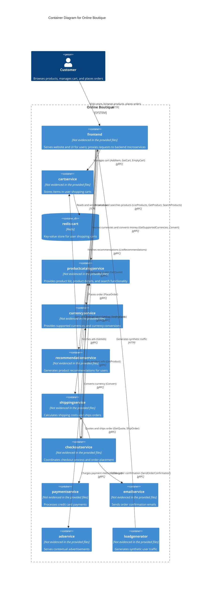

# Architecture Recovery: Online Boutique (Run B)

## 1. Agent
- **Product Name:** Gemini Code Assist / Antigravity
- **Model:** Gemini 3.8 Flash (High)

## 2. Files read
- `prompts/1-recover-architecture.md`
- `system/online-boutique/protos/demo.proto`
- `system/online-boutique/kubernetes-manifests/kustomization.yaml`
- `system/online-boutique/kubernetes-manifests/adservice.yaml`
- `system/online-boutique/kubernetes-manifests/cartservice.yaml`
- `system/online-boutique/kubernetes-manifests/checkoutservice.yaml`
- `system/online-boutique/kubernetes-manifests/currencyservice.yaml`
- `system/online-boutique/kubernetes-manifests/emailservice.yaml`
- `system/online-boutique/kubernetes-manifests/frontend.yaml`
- `system/online-boutique/kubernetes-manifests/loadgenerator.yaml`
- `system/online-boutique/kubernetes-manifests/paymentservice.yaml`
- `system/online-boutique/kubernetes-manifests/productcatalogservice.yaml`
- `system/online-boutique/kubernetes-manifests/recommendationservice.yaml`
- `system/online-boutique/kubernetes-manifests/shippingservice.yaml`
- `system/online-boutique/kubernetes-manifests/README.md`

## 3. Containers table

| Name | Technology / Language | Responsibility | Evidence (File Path) |
| :--- | :--- | :--- | :--- |
| `frontend` | Not evidenced in the provided files (Container image: `frontend`) | Serves the web UI and HTTP endpoints to customers; coordinates calls to backend microservices | `system/online-boutique/kubernetes-manifests/frontend.yaml` (lines 46–137) |
| `cartservice` | Not evidenced in the provided files (Container image: `cartservice`) | Provides gRPC interface to manage items in user shopping carts | `system/online-boutique/kubernetes-manifests/cartservice.yaml` (lines 37–83), `system/online-boutique/protos/demo.proto` (lines 23–27) |
| `redis-cart` | Redis (`redis:alpine`) | In-memory key-value data store for storing shopping cart data | `system/online-boutique/kubernetes-manifests/cartservice.yaml` (lines 90–156) |
| `productcatalogservice` | Not evidenced in the provided files (Container image: `productcatalogservice`) | Provides gRPC interface to list, get, and search products | `system/online-boutique/kubernetes-manifests/productcatalogservice.yaml` (lines 37–83), `system/online-boutique/protos/demo.proto` (lines 71–75) |
| `currencyservice` | Not evidenced in the provided files (Container image: `currencyservice`) | Provides gRPC interface for currency conversions and listing supported currencies | `system/online-boutique/kubernetes-manifests/currencyservice.yaml` (lines 38–83), `system/online-boutique/protos/demo.proto` (lines 140–143) |
| `recommendationservice` | Not evidenced in the provided files (Container image: `recommendationservice`) | Provides gRPC interface to generate recommended product lists based on user context | `system/online-boutique/kubernetes-manifests/recommendationservice.yaml` (lines 38–86), `system/online-boutique/protos/demo.proto` (lines 56–58) |
| `shippingservice` | Not evidenced in the provided files (Container image: `shippingservice`) | Provides gRPC interface to produce shipping quotes and track/ship orders | `system/online-boutique/kubernetes-manifests/shippingservice.yaml` (lines 37–83), `system/online-boutique/protos/demo.proto` (lines 107–110) |
| `checkoutservice` | Not evidenced in the provided files (Container image: `checkoutservice`) | Orchestrates the order placement workflow across cart, currency, payment, shipping, product catalog, and email services | `system/online-boutique/kubernetes-manifests/checkoutservice.yaml` (lines 37–91), `system/online-boutique/protos/demo.proto` (lines 224–226) |
| `paymentservice` | Not evidenced in the provided files (Container image: `paymentservice`) | Provides gRPC interface to process credit card payment charges | `system/online-boutique/kubernetes-manifests/paymentservice.yaml` (lines 38–82), `system/online-boutique/protos/demo.proto` (lines 177–179) |
| `emailservice` | Not evidenced in the provided files (Container image: `emailservice`) | Provides gRPC interface to send order confirmation emails | `system/online-boutique/kubernetes-manifests/emailservice.yaml` (lines 38–84), `system/online-boutique/protos/demo.proto` (lines 199–201) |
| `adservice` | Not evidenced in the provided files (Container image: `adservice`) | Provides gRPC interface to return targeted advertisements based on context keys | `system/online-boutique/kubernetes-manifests/adservice.yaml` (lines 38–84), `system/online-boutique/protos/demo.proto` (lines 243–245) |
| `loadgenerator` | Not evidenced in the provided files (Container image: `loadgenerator`) | Generates simulated user requests and workload against the frontend web service | `system/online-boutique/kubernetes-manifests/loadgenerator.yaml` (lines 15–95) |

## 4. Dependencies table

| Caller → Callee | Protocol | Evidence (File Path and Symbol / Environment Variable) |
| :--- | :--- | :--- |
| `Customer` → `frontend` | HTTP | `system/online-boutique/kubernetes-manifests/frontend.yaml` (Service `frontend-external`, lines 123–137, port 80 → targetPort 8080) |
| `loadgenerator` → `frontend` | HTTP | `system/online-boutique/kubernetes-manifests/loadgenerator.yaml` (`FRONTEND_ADDR="frontend:80"`, lines 70, 83) |
| `frontend` → `adservice` | gRPC | `system/online-boutique/kubernetes-manifests/frontend.yaml` (`AD_SERVICE_ADDR="adservice:9555"`, line 82); `system/online-boutique/protos/demo.proto` (`service AdService`, line 243) |
| `frontend` → `cartservice` | gRPC | `system/online-boutique/kubernetes-manifests/frontend.yaml` (`CART_SERVICE_ADDR="cartservice:7070"`, line 74); `system/online-boutique/protos/demo.proto` (`service CartService`, line 23) |
| `frontend` → `checkoutservice` | gRPC | `system/online-boutique/kubernetes-manifests/frontend.yaml` (`CHECKOUT_SERVICE_ADDR="checkoutservice:5050"`, line 80); `system/online-boutique/protos/demo.proto` (`service CheckoutService`, line 224) |
| `frontend` → `currencyservice` | gRPC | `system/online-boutique/kubernetes-manifests/frontend.yaml` (`CURRENCY_SERVICE_ADDR="currencyservice:7000"`, line 72); `system/online-boutique/protos/demo.proto` (`service CurrencyService`, line 140) |
| `frontend` → `productcatalogservice` | gRPC | `system/online-boutique/kubernetes-manifests/frontend.yaml` (`PRODUCT_CATALOG_SERVICE_ADDR="productcatalogservice:3550"`, line 70); `system/online-boutique/protos/demo.proto` (`service ProductCatalogService`, line 71) |
| `frontend` → `recommendationservice` | gRPC | `system/online-boutique/kubernetes-manifests/frontend.yaml` (`RECOMMENDATION_SERVICE_ADDR="recommendationservice:8080"`, line 76); `system/online-boutique/protos/demo.proto` (`service RecommendationService`, line 56) |
| `frontend` → `shippingservice` | gRPC | `system/online-boutique/kubernetes-manifests/frontend.yaml` (`SHIPPING_SERVICE_ADDR="shippingservice:50051"`, line 78); `system/online-boutique/protos/demo.proto` (`service ShippingService`, line 107) |
| `checkoutservice` → `cartservice` | gRPC | `system/online-boutique/kubernetes-manifests/checkoutservice.yaml` (`CART_SERVICE_ADDR="cartservice:7070"`, line 68); `system/online-boutique/protos/demo.proto` (`service CartService`, line 23) |
| `checkoutservice` → `currencyservice` | gRPC | `system/online-boutique/kubernetes-manifests/checkoutservice.yaml` (`CURRENCY_SERVICE_ADDR="currencyservice:7000"`, line 66); `system/online-boutique/protos/demo.proto` (`service CurrencyService`, line 140) |
| `checkoutservice` → `emailservice` | gRPC | `system/online-boutique/kubernetes-manifests/checkoutservice.yaml` (`EMAIL_SERVICE_ADDR="emailservice:5000"`, line 64); `system/online-boutique/protos/demo.proto` (`service EmailService`, line 199) |
| `checkoutservice` → `paymentservice` | gRPC | `system/online-boutique/kubernetes-manifests/checkoutservice.yaml` (`PAYMENT_SERVICE_ADDR="paymentservice:50051"`, line 62); `system/online-boutique/protos/demo.proto` (`service PaymentService`, line 177) |
| `checkoutservice` → `productcatalogservice` | gRPC | `system/online-boutique/kubernetes-manifests/checkoutservice.yaml` (`PRODUCT_CATALOG_SERVICE_ADDR="productcatalogservice:3550"`, line 58); `system/online-boutique/protos/demo.proto` (`service ProductCatalogService`, line 71) |
| `checkoutservice` → `shippingservice` | gRPC | `system/online-boutique/kubernetes-manifests/checkoutservice.yaml` (`SHIPPING_SERVICE_ADDR="shippingservice:50051"`, line 60); `system/online-boutique/protos/demo.proto` (`service ShippingService`, line 107) |
| `recommendationservice` → `productcatalogservice` | gRPC | `system/online-boutique/kubernetes-manifests/recommendationservice.yaml` (`PRODUCT_CATALOG_SERVICE_ADDR="productcatalogservice:3550"`, line 61); `system/online-boutique/protos/demo.proto` (`service ProductCatalogService`, line 71) |
| `cartservice` → `redis-cart` | TCP | `system/online-boutique/kubernetes-manifests/cartservice.yaml` (`REDIS_ADDR="redis-cart:6379"`, line 51; Service `redis-cart` port 6379, line 155) |

## 5. Mermaid diagram

## 6. Gaps

1. **Programming languages and application runtime technologies:**
   - Manifests specify container image tags (e.g. `image: frontend`, `image: cartservice`, `image: checkoutservice`) and port configurations, but do not evidence the actual programming languages (e.g., Go, C#, Java, Python, Node.js) or web frameworks used to implement each service.
   - Extra files to settle: Service source directories and build files (e.g., `src/<service>/Dockerfile`, `src/<service>/package.json`, `src/<service>/go.mod`, `src/<service>/requirements.txt`, `src/<service>/pom.xml`, or `src/<service>/*.csproj`).

2. **Persistence and backend data storage for other services:**
   - While `cartservice` explicitly provisions and configures `redis-cart` as its backend data store, no database containers, external DB connection strings, or PersistentVolumeClaims are evidenced for `productcatalogservice`, `checkoutservice`, `paymentservice`, or `emailservice`. It is unevidenced whether these services store data in-memory, rely on local files, or are entirely stateless.
   - Extra files to settle: Source code for data-handling services (e.g., `src/productcatalogservice/products.json`, `src/productcatalogservice/server.go`).

3. **Status of Shopping Assistant Service (`shoppingassistantservice`):**
   - In `system/online-boutique/kubernetes-manifests/frontend.yaml` (line 84), `SHOPPING_ASSISTANT_SERVICE_ADDR="shoppingassistantservice:80"` is defined, but the feature flag `# - name: ENABLE_ASSISTANT` is commented out (line 93). Furthermore, no manifest for `shoppingassistantservice` exists in `kubernetes-manifests/` (in `kustomization.yaml` line 35, `# - ../kustomize/components/shopping-assistant` is commented out), and no service definition exists in `demo.proto`. It could not be determined if this service is intended as an active component.
   - Extra files to settle: `system/online-boutique/kustomize/components/shopping-assistant/` and `src/shoppingassistantservice/`.

4. **Status of Packaging Service (`packaging service`):**
   - `frontend.yaml` mentions `# - name: PACKAGING_SERVICE_URL` in comments as an optional microservice demo, but no manifest or proto definition is provided.
   - Extra files to settle: Optional component manifests under `system/online-boutique/kustomize/components/`.

5. **External integrations for payments and emails:**
   - `paymentservice` and `emailservice` expose internal gRPC APIs (`Charge`, `SendOrderConfirmation`), but their manifests lack environment variables or secrets for third-party gateways (such as Stripe, PayPal, SendGrid, or SMTP credentials). It cannot be determined from proto and Kubernetes manifests alone whether they integrate with external providers or merely mock/simulate transactions.
   - Extra files to settle: Implementation source code in `src/paymentservice/` and `src/emailservice/`.
