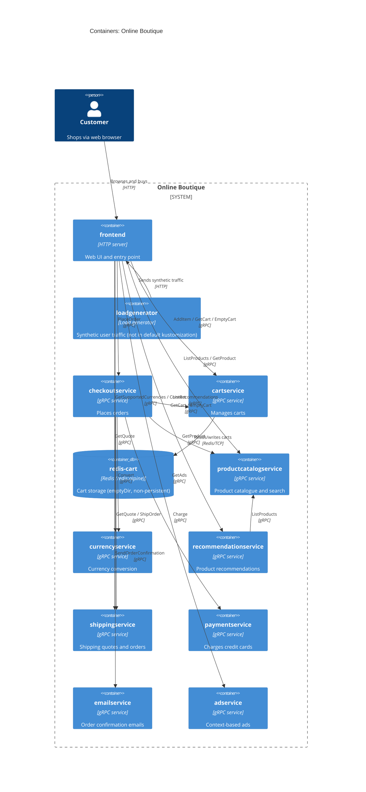

# Task 1 (run B): Recovered C4 container architecture: Online Boutique

## 1. Agent

Claude Code (Anthropic CLI), model **Claude Opus 5.5** (`claude-opus-5-5`).

## 2. Files read

All paths are relative to `system/online-boutique/`.

- `protos/demo.proto`
- `kubernetes-manifests/` (directory listing)
- `kubernetes-manifests/adservice.yaml`
- `kubernetes-manifests/cartservice.yaml`
- `kubernetes-manifests/checkoutservice.yaml`
- `kubernetes-manifests/currencyservice.yaml`
- `kubernetes-manifests/emailservice.yaml`
- `kubernetes-manifests/frontend.yaml`
- `kubernetes-manifests/kustomization.yaml`
- `kubernetes-manifests/loadgenerator.yaml`
- `kubernetes-manifests/paymentservice.yaml`
- `kubernetes-manifests/productcatalogservice.yaml`
- `kubernetes-manifests/recommendationservice.yaml`
- `kubernetes-manifests/shippingservice.yaml`
- `kubernetes-manifests/README.md`

## 3. Containers table

**Technology/language:** the manifests give only bare image names (e.g. `image: frontend`), so the implementation language of each service is **Not evidenced in the provided files**. `demo.proto` has `option go_package` (line 19), but that only configures Go code generation. It does not say which language each service is written in. Where the evidence shows the interface technology (gRPC/HTTP), the table lists it.

| Container | Technology / language | Responsibility | Evidence |
|---|---|---|---|
| `frontend` | HTTP server, port 8080 (language not evidenced) | Web UI and entry point for the shop. Exposed externally through a `LoadBalancer` service. Calls the backend services. | `kubernetes-manifests/frontend.yaml` (Service `frontend-external`, `type: LoadBalancer`; `httpGet /_healthz`; port name `http`) |
| `cartservice` | gRPC server, port 7070 (language not evidenced) | Manages shopping carts: `AddItem`, `GetCart`, `EmptyCart` | `protos/demo.proto` (`service CartService`, lines 23–27); `kubernetes-manifests/cartservice.yaml` (port `grpc` 7070, `grpc` probes) |
| `redis-cart` | Redis (`redis:alpine`), port 6379 | Stores cart data for `cartservice`. Uses an `emptyDir` volume, so the data is not persistent. | `kubernetes-manifests/cartservice.yaml` (Deployment `redis-cart`, `image: redis:alpine`, `volumes: redis-data emptyDir`) |
| `productcatalogservice` | gRPC server, port 3550 (language not evidenced) | Product catalogue: `ListProducts`, `GetProduct`, `SearchProducts` | `protos/demo.proto` (`service ProductCatalogService`, lines 71–75); `kubernetes-manifests/productcatalogservice.yaml` (port `grpc` 3550) |
| `currencyservice` | gRPC server, port 7000 (language not evidenced) | Currency conversion: `GetSupportedCurrencies`, `Convert` | `protos/demo.proto` (`service CurrencyService`, lines 140–143); `kubernetes-manifests/currencyservice.yaml` (port `grpc` 7000) |
| `recommendationservice` | gRPC server, port 8080 (language not evidenced) | Product recommendations: `ListRecommendations` | `protos/demo.proto` (`service RecommendationService`, lines 56–58); `kubernetes-manifests/recommendationservice.yaml` (port `grpc` 8080) |
| `shippingservice` | gRPC server, port 50051 (language not evidenced) | Shipping quotes and shipping orders: `GetQuote`, `ShipOrder` | `protos/demo.proto` (`service ShippingService`, lines 107–110); `kubernetes-manifests/shippingservice.yaml` (port `grpc` 50051) |
| `checkoutservice` | gRPC server, port 5050 (language not evidenced) | Places orders: `PlaceOrder` (returns `OrderResult`) | `protos/demo.proto` (`service CheckoutService`, lines 224–226); `kubernetes-manifests/checkoutservice.yaml` (port `grpc` 5050) |
| `paymentservice` | gRPC server, port 50051 (language not evidenced) | Charges credit cards: `Charge` (returns `transaction_id`) | `protos/demo.proto` (`service PaymentService`, lines 177–179); `kubernetes-manifests/paymentservice.yaml` (port `grpc` 50051) |
| `emailservice` | gRPC server; Service port 5000 → container port 8080 (language not evidenced) | Sends order confirmations: `SendOrderConfirmation` | `protos/demo.proto` (`service EmailService`, lines 199–201); `kubernetes-manifests/emailservice.yaml` (Service port `grpc` 5000, `targetPort: 8080`) |
| `adservice` | gRPC server, port 9555 (language not evidenced) | Returns context-based ads: `GetAds` | `protos/demo.proto` (`service AdService`, lines 243–245); `kubernetes-manifests/adservice.yaml` (port `grpc` 9555) |
| `loadgenerator` | Workload generator (language not evidenced); `busybox` init container | Generates synthetic user traffic against `frontend` (`USERS=10`, `RATE=1`). It is commented out of `kustomization.yaml`, so it is not part of the default deployment. | `kubernetes-manifests/loadgenerator.yaml` (`FRONTEND_ADDR`, `USERS`, `RATE`); `kubernetes-manifests/kustomization.yaml` (line 24, `# - loadgenerator.yaml`) |

## 4. Dependencies table

**How the protocol was determined:** each gRPC callee exposes a Service port named `grpc` and uses `grpc` readiness/liveness probes, and its interface is a `service` in `demo.proto`. The callee is identified by the `*_ADDR` environment variable in the caller's manifest.

| Caller → Callee | Protocol | Evidence (file · symbol / env var) |
|---|---|---|
| Customer → `frontend` | HTTP | `kubernetes-manifests/frontend.yaml` (Service `frontend-external`, `type: LoadBalancer`, port name `http` 80 → 8080) |
| `loadgenerator` → `frontend` | HTTP | `kubernetes-manifests/loadgenerator.yaml` (`FRONTEND_ADDR=frontend:80`; init container `wget http://${FRONTEND_ADDR}`) |
| `frontend` → `productcatalogservice` | gRPC | `kubernetes-manifests/frontend.yaml` (`PRODUCT_CATALOG_SERVICE_ADDR=productcatalogservice:3550`) |
| `frontend` → `currencyservice` | gRPC | `kubernetes-manifests/frontend.yaml` (`CURRENCY_SERVICE_ADDR=currencyservice:7000`) |
| `frontend` → `cartservice` | gRPC | `kubernetes-manifests/frontend.yaml` (`CART_SERVICE_ADDR=cartservice:7070`) |
| `frontend` → `recommendationservice` | gRPC | `kubernetes-manifests/frontend.yaml` (`RECOMMENDATION_SERVICE_ADDR=recommendationservice:8080`) |
| `frontend` → `shippingservice` | gRPC | `kubernetes-manifests/frontend.yaml` (`SHIPPING_SERVICE_ADDR=shippingservice:50051`) |
| `frontend` → `checkoutservice` | gRPC | `kubernetes-manifests/frontend.yaml` (`CHECKOUT_SERVICE_ADDR=checkoutservice:5050`) |
| `frontend` → `adservice` | gRPC | `kubernetes-manifests/frontend.yaml` (`AD_SERVICE_ADDR=adservice:9555`) |
| `checkoutservice` → `productcatalogservice` | gRPC | `kubernetes-manifests/checkoutservice.yaml` (`PRODUCT_CATALOG_SERVICE_ADDR=productcatalogservice:3550`) |
| `checkoutservice` → `shippingservice` | gRPC | `kubernetes-manifests/checkoutservice.yaml` (`SHIPPING_SERVICE_ADDR=shippingservice:50051`) |
| `checkoutservice` → `paymentservice` | gRPC | `kubernetes-manifests/checkoutservice.yaml` (`PAYMENT_SERVICE_ADDR=paymentservice:50051`) |
| `checkoutservice` → `emailservice` | gRPC | `kubernetes-manifests/checkoutservice.yaml` (`EMAIL_SERVICE_ADDR=emailservice:5000`) |
| `checkoutservice` → `currencyservice` | gRPC | `kubernetes-manifests/checkoutservice.yaml` (`CURRENCY_SERVICE_ADDR=currencyservice:7000`) |
| `checkoutservice` → `cartservice` | gRPC | `kubernetes-manifests/checkoutservice.yaml` (`CART_SERVICE_ADDR=cartservice:7070`) |
| `recommendationservice` → `productcatalogservice` | gRPC | `kubernetes-manifests/recommendationservice.yaml` (`PRODUCT_CATALOG_SERVICE_ADDR=productcatalogservice:3550`) |
| `cartservice` → `redis-cart` | Redis protocol over TCP | `kubernetes-manifests/cartservice.yaml` (`REDIS_ADDR=redis-cart:6379`; Service port name `tcp-redis`) |

## 5. Mermaid diagram

**Note on Rel labels:** the env vars prove that each dependency exists, but they do not show which RPCs each caller actually invokes. The RPC names in the labels are the operations the callee's `demo.proto` service offers. They are **[Inferred]** as the calls made in each case (see Gaps).

## 6. Gaps

| Gap | Why it can't be determined | File that would settle it |
|---|---|---|
| Implementation language of every service | Manifests use bare image names (`image: frontend` etc.); `go_package` in `demo.proto` only configures code generation | Each service's `Dockerfile` / source folder under `system/online-boutique/src/<service>/` |
| `shoppingassistantservice` | `frontend.yaml` sets `SHOPPING_ASSISTANT_SERVICE_ADDR=shoppingassistantservice:80`, but no manifest in the evidence deploys it and `demo.proto` has no such service. `kustomization.yaml` lists it only as a commented-out component (`../kustomize/components/shopping-assistant`). Left out of the diagram. | `kustomize/components/shopping-assistant/` and frontend source (`src/frontend/`) |
| Which RPCs each caller actually invokes (e.g. does `frontend` call `ShipOrder` or only `GetQuote`?) | Env vars show only that a connection is configured | Caller source code, e.g. `src/frontend/handlers.go`, `src/checkoutservice/main.go` |
| Whether the frontend → backend calls really are gRPC on the client side | The protocol is inferred from the callee side (port name `grpc`, gRPC probes, proto) | `src/frontend/` client code |
| External systems: a real payment gateway, an SMTP/email provider, an ad network | No external endpoint, secret or env var appears in the evidence. **[Inferred]** `paymentservice` and `emailservice` may be mocks. | `src/paymentservice/`, `src/emailservice/` source |
| `PACKAGING_SERVICE_URL` (optional "packaging service") | Commented out in `frontend.yaml` (lines 97–99) | `src/frontend/` source and its docs |
| Optional data-store variants: `memorystore`, `alloydb`, `spanner` | Only named as commented-out components in `kustomization.yaml` (lines 32–36). The default cart store is in-cluster `redis-cart`. | `kustomize/components/{memorystore,alloydb,spanner}/` |
| Where product catalogue, ads and currency rate data come from | No data store or volume is configured for those services | `src/productcatalogservice/`, `src/adservice/`, `src/currencyservice/` source |
| Actual deployable images and tags | `kubernetes-manifests/README.md` says these manifests need `skaffold` for image tags and points to `/release` | `release/kubernetes-manifests.yaml`, `skaffold.yaml` |
